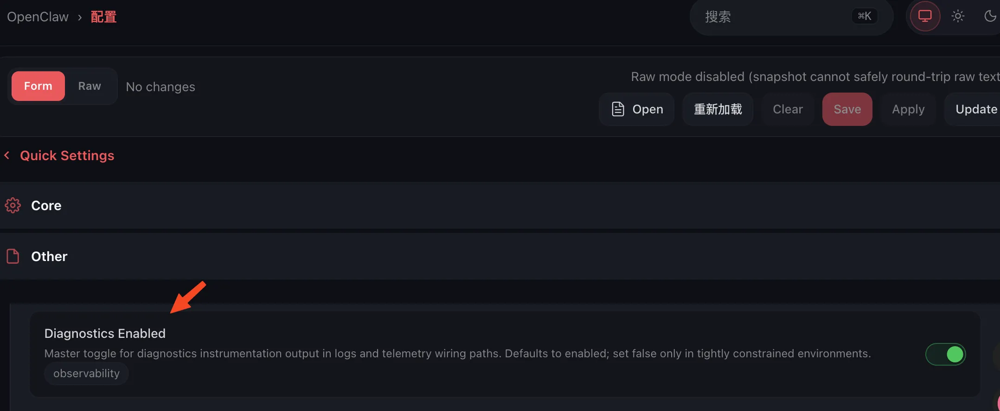
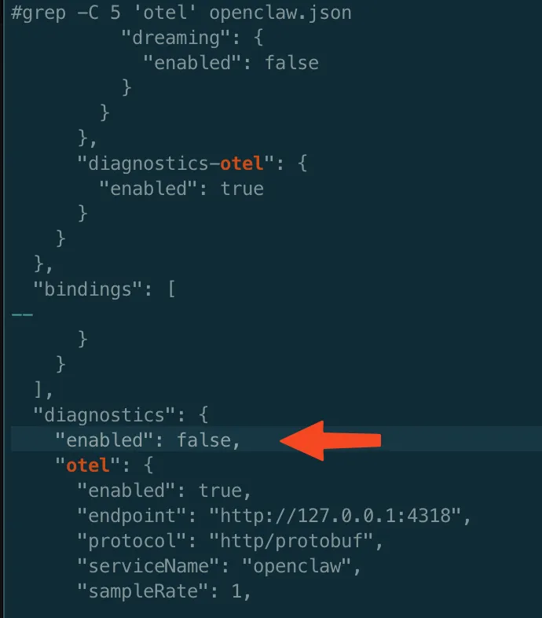
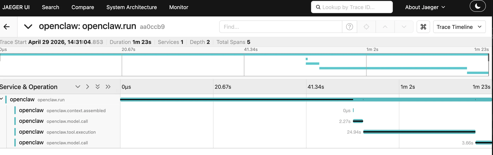

Agent 回复突然变慢，一条消息背后可能走了好几轮 LLM 调用、多次工具执行、甚至 Agent 间嵌套委派。没有端到端的链路追踪，排查"为什么这次慢了 40 秒"就只能翻日志硬猜。

[OpenClaw](https://github.com/openclaw/openclaw) 内置了 `diagnostics-otel` 插件，支持通过 OTLP/HTTP 导出 LLM 调用、工具执行、消息处理等诊断事件。配了 Jaeger 试用了一下，10 分钟搞定，**零代码侵入**，效果超出预期。把过程记录一下。

---

## 背景：Agent 调用链已经是个分布式系统了

现在一条用户消息进到 Agent 之后，背后可能是这样的链路：

- 多轮 LLM 调用（推理、工具选择、回复生成）
- 多次工具执行（读文件、调 API、查数据库）
- Agent 间委派（子 Agent 处理子任务）

这本质上就是个**分布式系统**，分布式系统就需要分布式追踪。但大多数 Agent 框架就给你几行控制台日志，这谁顶得住。

OpenClaw 的 `diagnostics-otel` 插件直接对接了云原生通用的 OTLP/HTTP 协议，LLM 调用、工具执行、消息处理全链路都能上报。

---

## 方案：OpenClaw + Jaeger，10 分钟搞定

### 整体架构

```
┌──────────────────────────────────────────────┐
│                                              │
│  ┌──────────────┐     ┌────────────────────┐ │
│  │ OpenClaw     │────→│ Jaeger all-in-one  │ │
│  │ diagnostics- │ :4318│ OTLP/HTTP :4318   │ │
│  │ otel 插件    │     │ UI :16686          │ │
│  └──────────────┘     │ 存储: badger       │ │
│                       └────────────────────┘ │
│                                              │
│  浏览器访问: http://<host>:16686            │
└──────────────────────────────────────────────┘
```

Jaeger all-in-one 镜像把 collector、query、UI 和 badger 存储全塞一个容器里，开箱即用，适合试用和小规模部署。

### 第一步：部署 Jaeger

```bash
docker run -d --name jaeger \
  -p 16686:16686 \
  -p 4317:4317 \
  -p 4318:4318 \
  -e COLLECTOR_OTLP_ENABLED=true \
  jaegertracing/all-in-one:latest
```

三个端口说明：
- `16686` — Jaeger Web UI
- `4317` — OTLP/gRPC
- `4318` — OTLP/HTTP（我们用这个）

### 第二步：配置 OpenClaw

OpenClaw Gateway 自带配置编辑器，页面上直接开关诊断功能：



也可以在 `openclaw.json` 里直接写：

```json
{
  "diagnostics": {
    "enabled": true,
    "otel": {
      "enabled": true,
      "endpoint": "http://<jaeger-host>:4318",
      "protocol": "http/protobuf",
      "serviceName": "openclaw",
      "sampleRate": 1.0,
      "traces": true,
      "metrics": true,
      "logs": true,
      "flushIntervalMs": 5000
    }
  }
}
```



不需要装任何 SDK，不用写一行埋点代码。插件挂载到 OpenClaw 内部事件总线上，诊断事件自动映射为 OpenTelemetry Span。

### 第三步：验证 trace 数据

发一条消息触发 Agent 处理后，检查 Jaeger API：

```bash
# 查看已注册的 service
curl -s http://<jaeger-host>:16686/api/services
# {"data":["jaeger-all-in-one","openclaw"],"total":2,...}

# 拉取最近的 trace
curl -s "http://<jaeger-host>:16686/api/traces?service=openclaw&limit=3"
```

`openclaw` 出现在 services 列表里就说明通了，打开 `http://<jaeger-host>:16686` 能看到 Trace 数据。

---

## 实际效果：一次 1 分 23 秒的会话

下图是一条真实消息的 trace 数据，整个会话耗时 1 分 23 秒：



Span 层级一目了然：

```
openclaw.run (1m 23s)
├── openclaw.context.assembled
├── openclaw.model.call (2.27s)
├── openclaw.tool.execution (24.94s)   ← 瓶颈在这里
└── openclaw.model.call (3.66s)
```

那 25 秒的工具执行直接跳出来——不需要猜，一眼就看到哪个环节在拖后腿。LLM 调用耗时、工具执行耗时、上下文组装耗时，清清楚楚。

---

## 踩坑：Span 没有父子关系（已修复）

> openclaw 4.24 之后版本才修复了这个问题。

部署成功后 Jaeger UI 确实收到了数据，但每条 trace 里只有一个孤零零的 span：

```
trace_1:  [openclaw.message.processed]  40s
trace_2:  [openclaw.model.usage]        37s   ← 本应是 message.processed 的子 span
```

LLM 调用（`model.usage`）和消息处理（`message.processed`）应该是父子关系，却被导出成了完全独立的 trace。

**根因**：`diagnostics-otel` 插件源码中，`spanWithDuration` 创建 Span 时没有传入 Parent Context：

```javascript
const spanWithDuration = (name, attributes, durationMs) => {
    return tracer.startSpan(name, { attributes, ... });
    //                          ↑ 缺第三参数 parentContext
};
```

每个诊断事件是异步独立触发的，Span Context 没有在事件之间传播，所以每个 Span 都成了独立 Trace 的 Root。

**修复**：社区在 [openclaw#21290](https://github.com/openclaw/openclaw/pull/21290) 中修了，引入了正确的 Span 层级：

```
openclaw.message (root)
  ├── invoke_agent
  │   ├── gen_ai.* (LLM 调用)
  │   └── tool.execution (工具调用)
  └── run.completed
```

用旧版本的话务必升级，Trace 质量天差地别。

---

## 生产环境的几个注意点

**多实例区分**：多台机器向同一个 Jaeger 上报时，通过 `serviceName` 区分：

```json
"serviceName": "openclaw-worker-15"
```

也可以通过环境变量补充更多 resource attribute：

```bash
OTEL_RESOURCE_ATTRIBUTES="deployment.environment=prod,service.instance.id=worker-3"
```

**采样率**：`sampleRate: 1.0` 是全量采集，调试时好用，生产环境记得调低。

**存储**：Jaeger all-in-one 默认用 badger 嵌入式存储，生产环境建议换 Elasticsearch 或 Cassandra 作为后端。

另外 OpenClaw Gateway 支持**动态开关诊断功能**，不需要重启服务，这个体验不错。

---

## 附：SkyWalking 方案（失败记录）

> 时间有限可以跳过，记录在此供踩坑参考。

最初选的是 Apache SkyWalking 10.5.0-SNAPSHOT，它的 master 分支新增了 OTLP/HTTP 支持。尝试构建后发现，Trace 数据确实写入了 BanyanDB（Zipkin API 能查到），但 SkyWalking UI 的 Trace 页面始终为空。

原因：`OpenTelemetryTraceHandler` 把 OTLP Span 转成了 Zipkin 格式，写入了 `zipkinTrace` group；但 `queryTraces` GraphQL API 只查 `trace` group，两条路没通。可能是 10.5.0-SNAPSHOT 适配还没做完，等正式版发布再试。

---

## 总结

Agent 的调用链本质上是个分布式系统，分布式系统就该有分布式追踪。OpenClaw 的 OTLP 支持和 Jaeger 的单容器部署让这件事变得非常简单：

- **10 分钟**搭建完成
- **零代码改动**，插件式接入
- LLM 调用耗时、工具执行耗时、Span 层级**一目了然**

下次 Agent 响应变慢，在 Jaeger 里花 30 秒看一眼，比翻 30 分钟日志高效多了。
